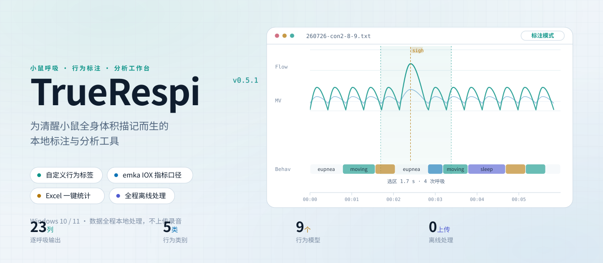
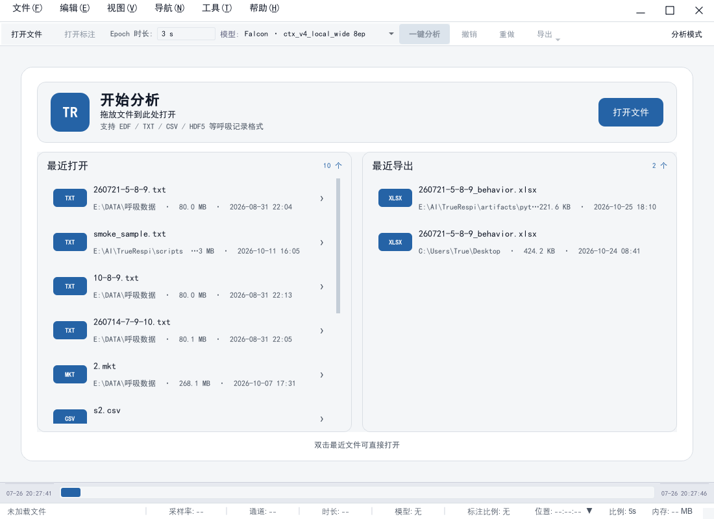
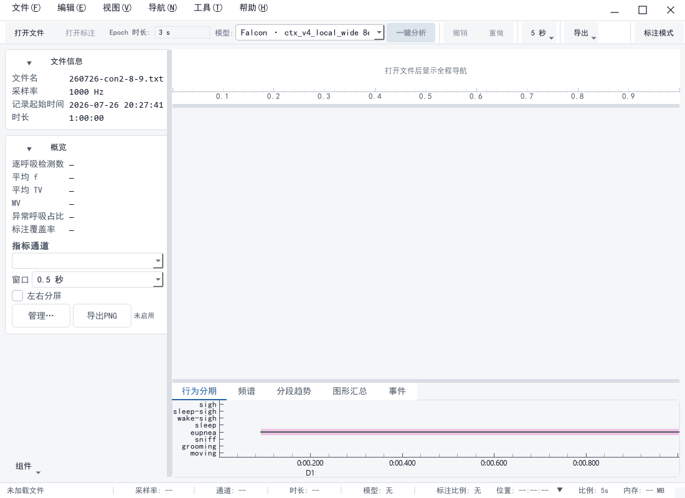

<div align="center">

<picture>
  <source media="(prefers-color-scheme: dark)" srcset="assets/diagrams/hero-dark.svg">
  
</picture>

<br>

[](https://github.com/BuTrue/TrueRespi/releases/latest)
[](https://github.com/BuTrue/TrueRespi/releases)
[](#系统要求)
[](LICENSE)

**简体中文** · [English](README.en.md) · [日本語](README.ja.md)

</div>

---

## 这是什么

TrueRespi 是面向**小鼠清醒全身体积描记（WBP）**的本地桌面工具：把 EMKA 等设备导出的原始呼吸流量波形
读进来，人工标注行为片段，再用内置行为模型做预标注，最后把逐呼吸参数、分段统计与图表一次性导出到 Excel。

> **本仓库只分发 Windows 安装包与更新清单，不包含源代码。** 源码、测试与开发文档不在本仓库发布。

<div align="center">
  
  <sub>主窗口（浅色）— 真实 10 分钟 EMKA 记录，标注段由呼吸检测结果派生</sub>
</div>

---

## 下载与安装

| 版本 | 文件 | 适用场景 |
|---|---|---|
| **安装版**（推荐） | `TrueRespi-<版本>-Setup.exe` | 需要开始菜单/桌面快捷方式、支持应用内自动覆盖升级 |
| **免安装版** | `TrueRespi-<版本>-win64-portable.zip` | 解压即用，适合无安装权限或便携部署 |
| 校验文件 | `SHA256SUMS.txt` | 下载后核对完整性 |

👉 **[下载最新版本](https://github.com/BuTrue/TrueRespi/releases/latest)**

### 系统要求

| 项目 | 要求 |
|---|---|
| 操作系统 | Windows 10 / 11，64 位 |
| 内存 | 4 GB 以上；处理数小时录音建议 8 GB 以上 |
| 磁盘 | 约 1 GB 可用空间（模型与运行库随包分发） |
| 显卡 | 可选。支持 DirectML 的显卡会自动加速模型推理，无显卡时回退 CPU |

### 安装步骤

1. 下载 `TrueRespi-<版本>-Setup.exe` 并双击运行。
2. 安装向导会请求管理员权限；若检测到正在运行的旧版本，会自动关闭后再替换文件。
3. 完成后从开始菜单或桌面快捷方式启动。

> 安装包未做商业代码签名，Windows SmartScreen 可能提示"未知发布者"。请确认文件确实来自本仓库
> Releases，并用 `SHA256SUMS.txt` 校验后再运行。

**免安装版**：解压到任意**可写目录**（不要在压缩包内直接运行），双击目录中的 `TrueRespi.exe`。
用户设置保存在 `%APPDATA%\TrueRespi`，项目与导出文件保存在你选择的目录。

---

## 主要能力

### 标注工作台

- **波形浏览**：多通道叠加、缩放平移、按时间跳转，GPU 加速渲染长录音。
- **行为标注**：拖选区间即标注，支持自定义行为标签与颜色；**允许区间重叠**（共同标注）。
- **项目文件**：保存为 `.truerespi` 工程，随时续标；旧版 `.deeprespi` 工程仍可直接打开。

### 模型预标注

内置 **9 个 Pneuma 行为模型**，覆盖五类行为（moving / grooming / sniff / eupnea / sleep），可在同一份数据上横向对比：

| 模型 | 架构与定位 |
|---|---|
| `condor` **（推荐默认）** | 4 模型 softmax 概率平均后接 HMM；准确率最高 |
| `falcon` | 单模型最优，macro-F1 全场最高、泛化最强，与 `condor` 仅差 0.22pp |
| `heron` | 机器学习类最优，仅需 103 维特征、不读原始波形，CPU 上最快 |
| `osprey` | Pneuma 主干 V9 分支架构，长上下文表现突出 |
| `swift` | 更轻量的机器学习模型，CPU 友好；macro-F1 略低于 `heron` |
| `eagle` / `kite` / `raven` / `swan` | 四个单模型骨干变体（V9 / V95 / InceptWave V70 / S4D-k255），用于骨干架构横向对照 |

推理走 ONNX，优先 DirectML GPU，失败自动回退 CPU；结果以行为段形式落到标注层，可逐段人工修订。

### 呼吸指标

- **逐呼吸输出 23 列**（`Ti` `Te` `P` `f` `PIF` `PEF` `TV` `EV` `MV` `RT` … `IF50`），对齐 emka IOX
  的 22 列口径并附派生量；泳道与窗口聚合使用其中 15 项核心参数。
- **指标注册表 56 项**，分五类（时序 / 幅度 / 变异性 / 事件 / 推论），每项含中文名、定义、公式、
  单位与最小数据条件。
- **不可用即留空**：仪器没测到、数据不足或计算失败一律写 `NaN`，**绝不填 0 伪造**——
  导出表里"留空"与"测到 0"始终可区分。

<div align="center">
  
  <sub>分析工作台 — 指标泳道与分段趋势联动，左侧为文件概览与通道指标</sub>
</div>

### Excel 导出

| 导出类型 | 内容 |
|---|---|
| **行为标注 Excel** | Sheet1 标注明细、各行为分窗统计（1/3/5/10 分钟）、30 分钟分段、趋势图、指标说明 |
| **全部数据 Excel** | 在行为工作簿基础上，追加「呼吸指标_每秒」与「呼吸指标_每分钟」两张表 |

「说明」工作表按**实际产出**的工作表逐条陈述，不会出现"文档说有、文件里没有"。

---

## 更新

- 安装版启动后会延迟检查更新，也可随时 **帮助 → 检查更新**。
- 发现新版本后可在应用内下载，完成 **SHA-256 校验**后再运行安装程序；同 AppId 覆盖安装，
  **保留用户设置**。
- 免安装版请从 Releases 下载新版 zip 覆盖程序目录，项目与导出文件不受影响。
- 更新清单：[`update/manifest.json`](update/manifest.json)。

---

## 文件校验

```powershell
Get-FileHash .\TrueRespi-<版本>-Setup.exe -Algorithm SHA256
Get-FileHash .\TrueRespi-<版本>-win64-portable.zip -Algorithm SHA256
```

与 [`SHA256SUMS.txt`](SHA256SUMS.txt) 比对。校验不一致请勿运行，重新下载。

---

## 数据与隐私

- **全程本地处理**：原始录音、标注、项目文件都不会上传到任何服务器。
- 应用内更新只访问本仓库的更新清单与发布资产。
- 反馈问题时请勿附带未授权的动物数据、个人信息或含敏感路径的截图。

---

## 反馈

- 问题与建议：[GitHub Issues](https://github.com/BuTrue/TrueRespi/issues)
- 版本记录：[CHANGELOG.md](CHANGELOG.md) · [发布说明](release-notes/)
- 联系邮箱：**namecyq@foxmail.com**

反馈时请提供：软件版本（关于页可见）、Windows 版本、数据格式、复现步骤与日志片段（请先脱敏）。

---

## 许可证

TrueRespi 以 **MIT License** 发布，详见 [LICENSE](LICENSE)。
第三方组件许可见安装目录中的 `THIRD_PARTY_LICENSES.txt`。

<div align="center"><sub>© 2026 TrueRespi Team · TrueRespi 名称与标识保留所有权利</sub></div>
