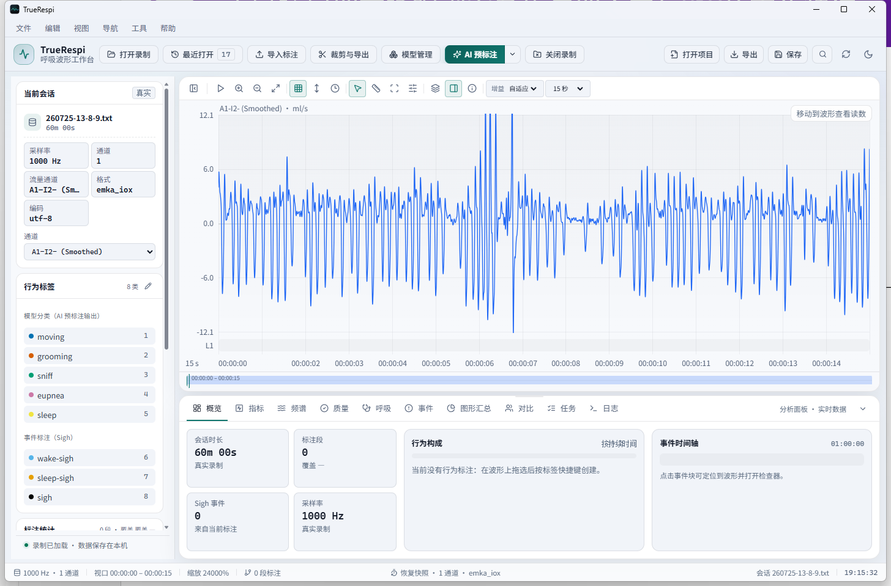
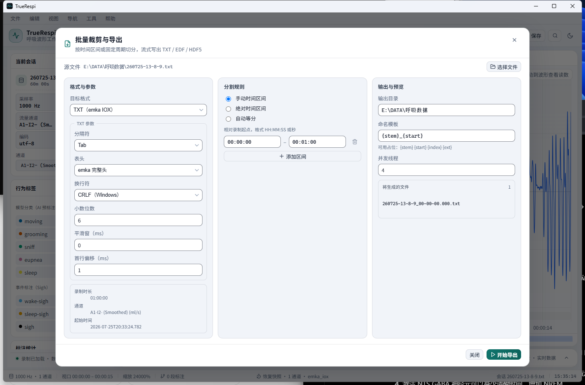
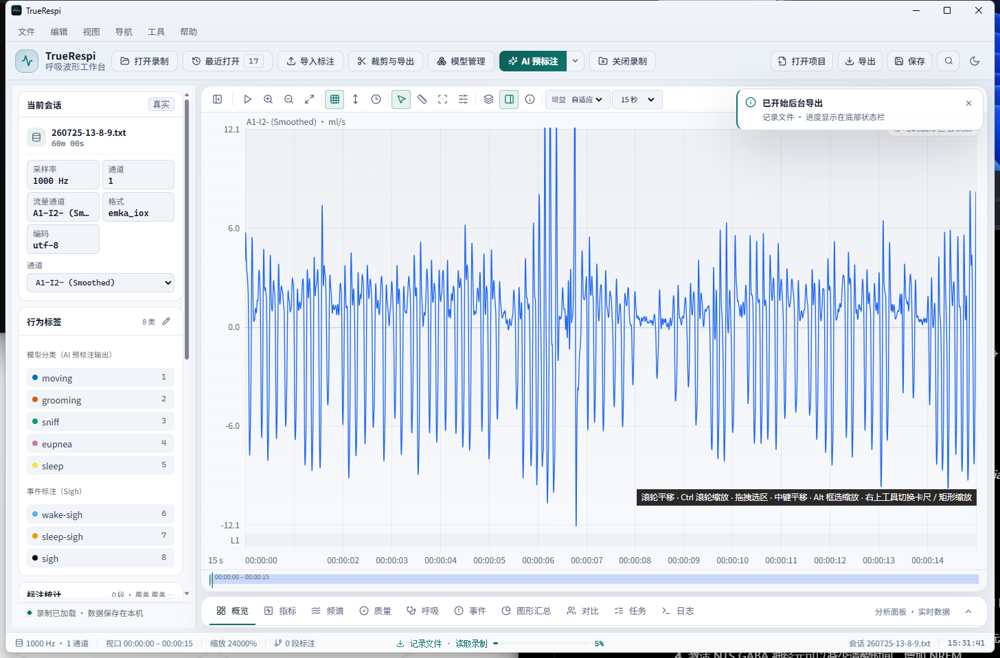
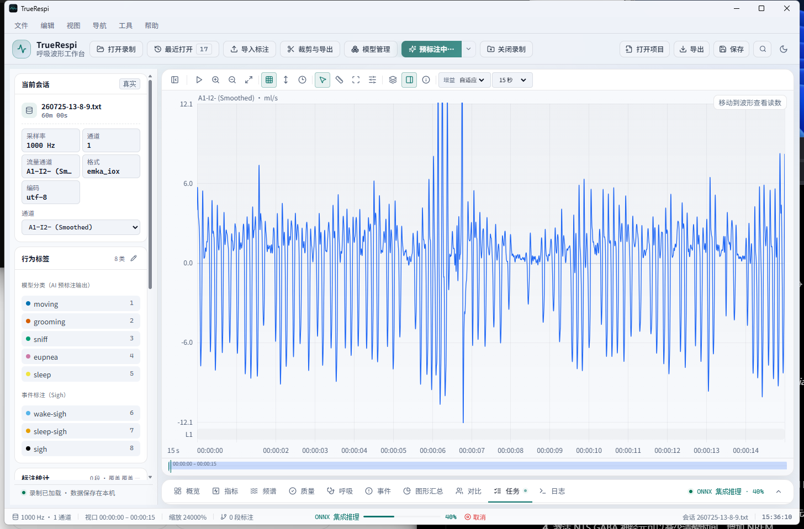

<p align="center">
  
</p>

<h1 align="center">TrueRespi</h1>

<p align="center">
  <b>小鼠 / 大鼠呼吸波形分析与行为标注工作台</b><br>
  面向全身体积描记（WBP）实验的中文桌面软件
</p>

<p align="center">
  <a href="https://github.com/BuTrue/TrueRespi/releases/latest">
    
  </a>
  <a href="https://github.com/BuTrue/TrueRespi/releases">
    
  </a>
  
  
</p>

<p align="center">
  <a href="#下载与安装">下载</a> ·
  <a href="#核心能力">功能</a> ·
  <a href="#命令行与-agent-接入">命令行 / Agent</a> ·
  <a href="#正式模型">模型</a> ·
  <a href="#文档">文档</a> ·
  <a href="#更新与覆盖安装">更新</a> ·
  <a href="#许可">许可</a>
</p>

---

## 真实界面演示

<p align="center">
  
</p>

<p align="center">
  <sub>波形工作台 → 裁剪与导出 → 后台导出进度 → AI 预标注 → 正式模型与工具入口</sub>
</p>

---

## 这是什么

TrueRespi 把小鼠 / 大鼠呼吸实验中最常用的几步放在同一个桌面工作台里：

- 打开 TXT、CSV、EDF、BDF、MKT、HDF5、NPZ 原始录制；
- 查看、缩放、平移多通道呼吸波形；
- 在时间轴上人工标注 moving / grooming / sniff / eupnea / sleep 与 sigh 事件；
- 使用正式发布的 Pneuma 模型进行 AI 预标注；
- 计算 Ti、Te、PIF、PEF、TV、EV、MV、RT 等呼吸指标；
- 导出行为标注 Excel、PDF 报告、标注 CSV、EDF / HDF5 / NPZ；
- 裁剪 MKT 与 LabChart `.adicht` 录制，输出 TXT / EDF / HDF5。

> 本仓库只发布 Windows 安装包、更新清单和中文文档，不包含源代码。

---

## 核心能力

<table>
<tr>
<td width="50%" valign="top">

### 波形工作台

- 多通道堆叠与通道切换
- 滚轮平移、Ctrl+滚轮缩放时间轴
- Shift+滚轮缩放 Y 轴（0.05–20 倍）
- 显示金字塔与深缩放 raw 波形
- 缩略图、卡尺、框选、矩形缩放
- 网格、增益、偏移、线宽、抗锯齿、桥接间隙

</td>
<td width="50%" valign="top">

### 行为标注

- 拖选后按标签快捷键标注
- 撤销 / 重做 / 拆分 / 删除
- 标注检查器：时间、时长、来源、置信度
- 标注统计：段数、累计时长、占比
- `.truerespi` 项目保存与恢复
- 兼容旧版 `.deeprespi` 项目与行为标注 Excel

</td>
</tr>
<tr>
<td width="50%" valign="top">

### AI 预标注

- Falcon / Heron / Osprey / Swift 四个正式模型
- ONNX 推理，后台运行
- 状态栏显示读取、加载模型、推理、整理标注进度
- 有兼容 DirectML 显卡时可加速，无显卡自动 CPU
- 结果作为一组可撤销标注写入

</td>
<td width="50%" valign="top">

### 导出与裁剪

- 行为标注 Excel：汇总、明细、分窗、30 分钟分段、图表
- PDF 报告、标注 CSV、EDF、HDF5、NPZ、PNG
- MKT / LabChart `.adicht` 裁剪
- 手动区间、绝对时间、每小时、每 X 分钟
- 后台导出，状态栏实时进度
- 命令行批量导出与 MCP Agent 接入

</td>
</tr>
</table>

---

## 界面预览

<table>
<tr>
<td width="50%">
  
  <p align="center"><sub>波形工作台与标注统计</sub></p>
</td>
<td width="50%">
  
  <p align="center"><sub>MKT / LabChart 裁剪与导出</sub></p>
</td>
</tr>
<tr>
<td width="50%">
  
  <p align="center"><sub>后台导出与状态栏进度</sub></p>
</td>
<td width="50%">
  
  <p align="center"><sub>AI 预标注后台进度</sub></p>
</td>
</tr>
</table>

---

## 命令行与 Agent 接入

安装包同时提供 `truerespi.exe` 与 `truerespi-mcp.exe`，无需打开桌面界面即可批量处理数据。

### 文件夹批量导出：每小时一个 TXT

```powershell
truerespi list "D:\呼吸数据" --recursive --ext mkt --json
truerespi crop "D:\呼吸数据" -o "D:\导出\每小时" --every 3600 --format txt --recursive --ext mkt
```

- 递归处理文件夹内所有 `.mkt`；
- 每个文件按 3600 秒切分，输出 `原文件名_00-00-00.000.txt`、`原文件名_01-00-00.000.txt`…；
- 最后一个不足 1 小时的分段也会保留；
- `--range start:end`、`--at "YYYY-MM-DD HH:MM:SS|HH:MM:SS"` 可指定任意区间；
- `--format edf` / `--format h5` 可导出其他格式。

### 接入 Agent（MCP）

Claude Desktop、Codex、OpenCode 等支持 MCP 的客户端可以直接加载：

```json
{
  "mcpServers": {
    "truerespi": {
      "command": "C:\\Users\\<用户名>\\AppData\\Local\\Programs\\TrueRespi\\bin\\truerespi-mcp.exe",
      "args": []
    }
  }
}
```

然后可以直接说：

> 把 `D:\呼吸数据` 下所有 mkt 文件每小时导出一个 txt，放到 `D:\导出\每小时`。

完整的 CLI 参数、MCP 工具说明和各客户端配置见 [命令行与 Agent](docs/命令行与Agent.md)。

---

## 正式模型

软件只展示以下 4 个正式模型；实验网格模型、中间模型和已停用集成模型不会出现在模型选择器中。

| 模型 | 定位 | 说明 |
|---|---|---|
| **Falcon · 推荐模型** | 默认推荐 | 综合表现最均衡，适合常规小鼠 WBP 录制 |
| **Heron · 快速模型** | 快速筛查 | 103 维呼吸特征，CPU 推理速度快 |
| **Osprey · 深度模型** | 复杂模式 | 多分支深度模型，资源占用相对较高 |
| **Swift · 轻量模型** | 批量预标注 | 体积小、启动快，适合大批量处理 |

模型文件随安装包发布，无需单独下载。

---

## 下载与安装

### 最新版本：0.1.1

| 文件 | 用途 |
|---|---|
| [TrueRespi-0.1.1-Setup.exe](https://github.com/BuTrue/TrueRespi/releases/download/v0.1.1/TrueRespi-0.1.1-Setup.exe) | Windows 安装包 |
| [SHA256SUMS.txt](https://github.com/BuTrue/TrueRespi/releases/download/v0.1.1/SHA256SUMS.txt) | 安装包校验值 |
| [install.ps1](https://github.com/BuTrue/TrueRespi/releases/download/v0.1.1/install.ps1) | 命令行下载、校验、静默安装 |

安装步骤：

1. 下载安装包并核对 SHA256。
2. 双击安装，阅读并接受中文许可协议。
3. 选择安装目录；默认当前用户目录，无需管理员权限。
4. 安装完成后从开始菜单或桌面快捷方式启动。

命令行静默安装：

```powershell
powershell -NoProfile -ExecutionPolicy Bypass -Command "irm https://raw.githubusercontent.com/BuTrue/TrueRespi/main/install.ps1 | iex"
```

安装包会把 `truerespi.exe`（CLI）和 `truerespi-mcp.exe`（MCP stdio 服务）安装到安装目录的 `bin` 子目录，并把该目录加入当前用户 `PATH`。新开终端后可直接运行 `truerespi --version`。

支持覆盖安装：新版本会沿用原安装目录，保留 `%APPDATA%\TrueRespi` 中的用户数据。

### 系统要求

| 项目 | 要求 |
|---|---|
| 操作系统 | Windows 10 / 11，64 位 |
| 处理器 | x64，支持 SSE4.2 |
| 内存 | 建议 8 GB 以上 |
| 磁盘 | 约 1 GB 可用空间 |
| 显卡 | 非必需；兼容 DirectML 的显卡可加速模型推理 |
| 运行环境 | Microsoft Edge WebView2 Runtime |

---

## 更新与覆盖安装

软件启动后会静默检查更新：

- 有新版本时，顶栏夜间模式按钮旁的检查更新按钮显示小箭头；
- 同一版本只自动提示一次；
- 发现新版本后自动在后台下载安装包，并显示下载进度；
- 下载完成后校验 SHA256，再启动安装程序；
- Inno Setup 安装包使用固定 AppId，支持覆盖安装，无需先卸载；
- 覆盖安装保留 `%APPDATA%\TrueRespi` 中的项目配置、偏好和日志。

更新窗口以“新增 / 改进 / 修复 / 注意事项”分节展示版本说明，不显示内部清单地址或缓存路径。

---

## 文档

| 文档 | 内容 |
|---|---|
| [安装说明](安装说明.md) | 全新安装、覆盖安装、静默安装、卸载与校验 |
| [使用说明](使用说明.md) | 界面、录制、标注、模型、导出、裁剪与更新 |
| [快速开始](docs/快速开始.md) | 5 分钟完成一次打开 → 标注 → 导出 |
| [命令行与 Agent](docs/命令行与Agent.md) | CLI 批量导出、MCP 配置与 Agent 使用示例 |
| [数据格式与兼容性](docs/数据格式与兼容性.md) | 支持格式、旧项目兼容、已知限制 |
| [模型说明](docs/模型说明.md) | 四个正式模型、选择建议与运行要求 |
| [更新与安装](docs/更新与安装.md) | 更新清单、自动下载、覆盖安装与校验 |
| [常见问题](docs/常见问题.md) | 安装、打开、模型、导出与性能问题 |
| [隐私与安全](docs/隐私与安全.md) | 本地数据处理、网络访问与备份建议 |
| [代码签名说明](代码签名说明.md) | 自签名与 CA 证书的区别 |
| [发布与校验](docs/发布与校验.md) | 构建、安装包、SHA256 与 Release 流程 |
| [更新记录](CHANGELOG.md) | 版本变更 |
| [许可协议](许可协议.txt) | 最终用户许可协议 |
| [第三方组件](第三方组件许可.txt) | 开源组件与许可说明 |

---

## 数据与隐私

- 录制、标注、项目文件和导出结果默认在本机处理。
- 软件不会主动上传原始录制、标注内容或分析结果。
- 更新检查只访问公开的更新清单地址，不包含用户数据。
- 请自行备份重要项目和导出文件。
- 本软件用于科研数据分析，不构成医疗器械、临床诊断工具或治疗建议。

---

## 许可

TrueRespi 可免费使用。禁止反向工程、反编译、反汇编、破解、修改、销售、转售、出租、付费分发或删除权利标识。

完整条款以 [许可协议](许可协议.txt) 为准。

---

## 反馈

- 问题反馈：https://github.com/BuTrue/TrueRespi/issues
- 发布页：https://github.com/BuTrue/TrueRespi/releases
- 项目主页：https://github.com/BuTrue/TrueRespi

<p align="center">
  <sub>© 2026 BuTrue. All rights reserved.</sub>
</p>
